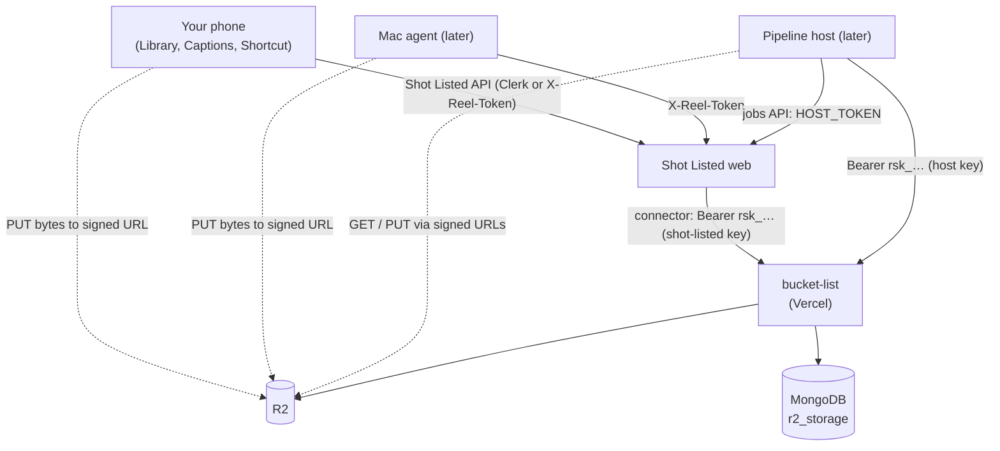

# bucket-list — App Flow

The service has no screens. Its "app flow" is the sequence of calls each caller makes. Status legend: **Done** (built and tested; not deployed) · **Planned**.

## 1. Who talks to whom

Only servers hold storage keys. Phones and the Mac get signed links from Shot Listed and talk to R2 directly for the bytes.

## 2. Flows

### 2.1 Small upload from the phone (≤ 64 MB) — Done

1. The phone hashes the file (SHA-256, 8 MiB at a time; the row shows **Checking**).
2. Phone → Shot Listed `POST /api/media/uploads` with name, type, size and hash.
3. Shot Listed checks the caller, sets the collection (`library` or `finals`) and its limits, and calls `POST /v1/uploads`.
4. Storage resolves the type and checks the rules, then the hash (TRD §6, *Duplicates and resuming*):
   - same bytes already uploaded in this collection → `duplicate` → phone shows **Already in library**;
   - same bytes, upload unfinished → a fresh link for the same asset;
   - otherwise a new `uploading` record and `{ mode: "single", url, headers }`.
5. Phone PUTs the file to R2 with exactly that Content-Type.
6. Phone → Shot Listed `/complete` → storage `/complete` → `HEAD` checks the size → `uploaded`.

### 2.2 Large upload in parts (> 64 MB) — Done

1. As above, but storage starts a multipart upload and returns `{ mode: "multipart", partSize, partCount }`.
2. Phone asks for part URLs in batches of 20 (up to 100 allowed).
3. Phone PUTs 4 parts at a time, retrying a failed part up to 3 times, and reads each part's `ETag` (needs the bucket CORS rule).
4. `/complete` with every `{ partNumber, etag }`.
5. ✕ cancels: `DELETE /v1/uploads/:id` aborts the upload.

### 2.3 Picking up a stopped upload — Done

The upload stopped part-way: signal dropped, Safari closed, the phone locked.

1. You tap **Retry**, or pick the same file again. The phone hashes it (Retry reuses the hash) and starts as in 2.1.
2. Storage finds the unfinished asset with that hash, asks R2 which parts arrived and returns `{ mode: "resume", uploadedParts }`.
3. The phone checks each listed part's size, starts the progress bar at that point (say 90%), and sends only the missing parts.
4. `/complete` with every part. Same asset and object as the first attempt; nothing stored twice.

Edge cases:

- Never tried again: the daily cleanup removes it after 24 hours without activity.
- Tried again more than a day later: R2 has dropped the parts, so storage starts a new multipart upload on the **same** asset.
- Running twice at once (two tabs): both send identical bytes to the same upload; the first to finish wins and the other's finish returns the same asset.
- A caller that kept the asset ID (the Mac agent) can skip hashing and call `GET /v1/uploads/:id`.

### 2.4 Showing the library — Done

1. Shot Listed calls `GET /v1/assets?collection=library&urls=thumb&limit=48` (and `before=<next>` for the next page).
2. Each item comes with a 1-hour link to its thumbnail, or to the original until the pipeline host makes thumbnails.
3. Usage bar: `GET /v1/usage`.

From phase 6, Shot Listed keeps its own `library_items` (tags, search data) and asks for links with `POST /v1/assets/urls`, one call per page.

### 2.5 Preview and download — Done

`POST /v1/assets/:id/url`: without options for viewing; with `{ "download": true }` for a link that saves under the original filename.

### 2.6 Delete — Done

Phone → Shot Listed `DELETE /api/media/assets/:id` → `DELETE /v1/assets/:id` → storage deletes the record, then the original and every variant. A delete R2 refuses is retried by the daily cleanup.

### 2.7 Final cut for captions — Done

1. Upload as 2.1 or 2.2 into `finals`, with `kinds: ["video"]` and `maxBytes: 524288000`. Duplicates are per collection, so a video that is also in the library is not reported as a duplicate.
2. The captions run downloads it through a signed link and sends it to Gemini.
3. **Delete video** → `DELETE /v1/assets/:id`; the captions stay in Shot Listed.

### 2.8 Mac mini sync — Server side Done; agent Planned

The agent calls Shot Listed with the Photos UUID (`externalId`) and the file's hash; Shot Listed passes both on.

- Re-runs: the Photos UUID is unique per app, so the Mac never stores a photo twice.
- Already uploaded from the phone with the **same bytes**: `duplicate` with `adopted: true`; the existing asset gets the Photos UUID.
- Already uploaded from the phone as a **different file** (iOS sent a converted copy): the bytes differ, so it is stored; Shot Listed recognises the pair later and calls merge (2.11). From phase 12, the agent asks Shot Listed first and skips anything it already has in an equal or better copy.

### 2.9 Indexing and variants (pipeline host) — Planned (Shot Listed phase 6)

1. The host gets an `index-asset` job from Shot Listed.
2. `POST /v1/assets/:id/url` → downloads the original; recomputes its hash; `PATCH` if the claimed one was wrong.
3. Makes a 1080p proxy and a thumbnail; for each: `POST /v1/assets/:id/variants` → PUT → `…/complete`.
4. Optional saving: `DELETE /v1/assets/:id/original` once the proxy is in.

### 2.10 Files the host creates — Planned

Downloaded inspiration reels (`inspirations`) and clip pack zips (`clip-packs`) are ordinary uploads made by the host with its own key.

### 2.11 Merging two copies of one shot — Done here; Shot Listed side Planned (phase 6)

Shot Listed decides two assets are the same photo or clip. After its 7-day undo window it calls `POST /v1/assets/<kept>/merge` with `{ "from": "<other>", "keepOriginal": "this" | "from" }`:

1. The kept asset's ID stays, so Shot Listed's tags and plans still point at it.
2. If the other copy is better, its original becomes the kept asset's original. Nothing is copied.
3. The losing file and the other asset's variants are deleted; the other record is removed.
4. Shot Listed re-creates thumbnails and the proxy if the original changed.

### 2.12 Keys — Done

1. After the first deploy: `ADMIN_TOKEN=… npm run create-key -- --url <storage url> --app shot-listed --name vercel --scopes read,write,delete`. Put the printed key in Shot Listed's `STORAGE_API_KEY`.
2. Later, the same with `--name pipeline-host` for the host.
3. To rotate: create a new key, update the caller, then `DELETE /v1/keys/:id` for the old one.

### 2.13 Daily cleanup — Done

Vercel Cron calls `GET /v1/cron/cleanup` at 03:00 UTC. It removes uploads untouched for 24 hours and retries failed deletes. The R2 lifecycle rule catches anything else.

## 3. Failure behaviour

| What happens | Caller sees | What to do |
| --- | --- | --- |
| Link expired (15 minutes) mid-upload | R2 returns 403 on PUT | Ask for new part URLs; for a single upload, start again and you get a fresh link to the same asset |
| Upload stopped part-way | Nothing until you retry | Retry, or pick the same file again: it resumes (2.3) |
| Content-Type differs from the signed one | R2 returns 403 | Send exactly the `headers` returned |
| Parts stitched but size wrong | 422 from complete; object removed | Upload again |
| Same file twice, from any device | `mode: "duplicate"` | Nothing |
| Same file while the first is still uploading | `mode: "resume"`; both finish as one asset | Nothing |
| Same photo as a different file | Stored, then merged by the app | Review in the app if it is unsure |
| Key revoked or wrong | 401 | Fix `STORAGE_API_KEY` |
| Key lacks a scope | 403 | Create a key with the scope |
| Asset belongs to another app | 404 | By design |
| Atlas cluster paused (30 days idle) | 500 from storage, 502 in Shot Listed | Resume it in the Atlas dashboard |
| First request after a quiet spell is slow | A second or two | Normal cold start; the connector waits and retries |
