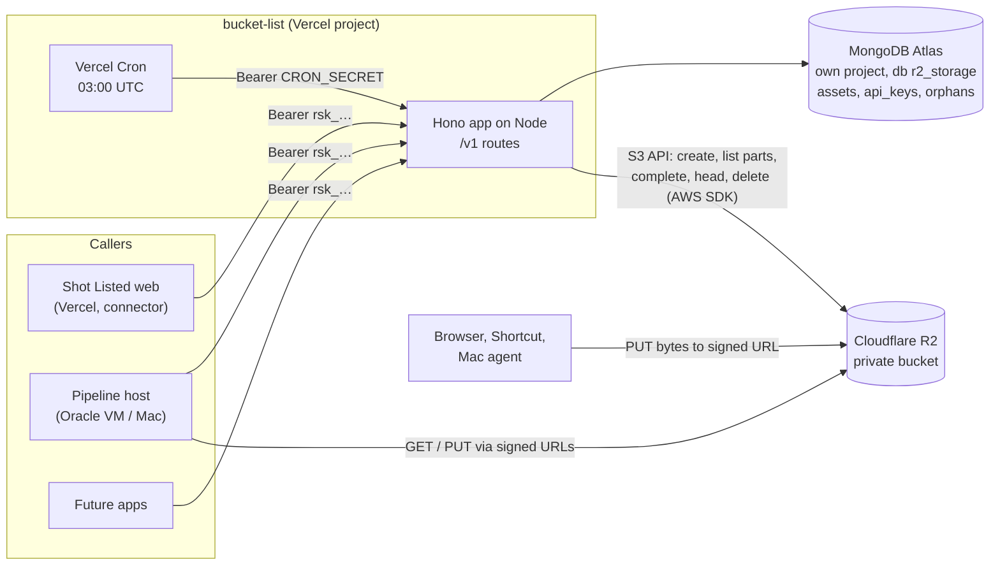

# bucket-list — Technical Design

Status legend: **Done** (built and tested; not deployed) · **Partly done** · **Planned**.

## 1. Architecture



The service never carries file bytes. It decides, signs and records; bytes go straight between the caller and R2.

## 2. Technology choices

| Choice | Why |
| --- | --- |
| Hono on Vercel (Node, Fluid compute) | Vercel runs a Hono app exported from `src/index.ts` with no configuration. Small, typed, testable in-process with `app.request()`. Same platform you already use. |
| MongoDB Atlas, own project and database | You already run Atlas; the code started on MongoDB. Its own project gives it its own free 512 MB cluster. The Node driver reuses one connection pool per warm function. Cloudflare D1 was the alternative, but it is only practical from Cloudflare Workers, and MongoDB is poor from Workers (a new connection per request). |
| AWS SDK v3 against R2's S3 API | Signing presigned URLs needs S3 credentials anyway; the same client does multipart, `ListParts` (for resuming), `HEAD` and deletes. Proven in Shot Listed before the split. |
| zod | Request validation, same as Shot Listed. |
| `openapi.yaml` | The contract Shot Listed's `storage/types.ts` follows. |
| node:test + tsx; moto for R2 | No extra test framework; moto is a local S3 stand-in. |

## 3. Repo layout

```
bucket-list/
├─ src/
│  ├─ index.ts        Vercel entry: builds dependencies on first request, exports the app
│  ├─ dev.ts          Local server on :8787 (@hono/node-server)
│  ├─ app.ts          Routes, auth middleware, validation, error shape
│  ├─ assets.ts       Uploads, duplicates, resuming, links, variants, merge, usage, cleanup
│  ├─ dedupe.ts       The duplicate rules, pure
│  ├─ apikeys.ts      Create, verify and show keys
│  ├─ policy.ts       Allowed types, size limits, part plans, link lifetimes
│  ├─ keys.ts         R2 key layout
│  ├─ r2.ts           R2 through the S3 API
│  ├─ env.ts          Environment, validated on first use
│  ├─ errors.ts       HttpError and DuplicateKeyError
│  └─ store/
│     ├─ types.ts     The Store interface and records
│     ├─ mongo.ts     MongoDB implementation, indexes, transactions for merge
│     └─ memory.ts    In-memory implementation with the same unique rules
├─ scripts/  create-key.ts  smoke.ts  import-shot-listed.ts
├─ test/     policy, store (memory; MongoDB when MONGODB_TEST_URI is set), api, s3, helpers
├─ infra/r2-cors.json
├─ openapi.yaml  vercel.json  .env.example  package.json  tsconfig.json  README.md
└─ docs/
```

## 4. Configuration

| Variable | Purpose |
| --- | --- |
| `MONGODB_URI`, `MONGODB_DB` (default `r2_storage`) | Atlas, its own project |
| `STORE` (default `mongo`) | `memory` for local trials and tests; refused in Vercel production |
| `R2_ACCOUNT_ID`, `R2_ACCESS_KEY_ID`, `R2_SECRET_ACCESS_KEY`, `R2_BUCKET` | R2 API token with Object Read & Write on this bucket only |
| `R2_ENDPOINT` (optional) | EU-jurisdiction bucket, or a local S3 mock |
| `ADMIN_TOKEN` | At least 32 characters; creates and revokes keys |
| `CRON_SECRET` | Vercel sends it to the cleanup route |
| `FREE_TIER_BYTES` (default 10 GiB) | For the usage response |

`vercel.json` schedules `GET /v1/cron/cleanup` at `0 3 * * *`.

## 5. Authentication

- Callers send `Authorization: Bearer <key>`. Key format: `rsk_<id>_<secret>`, with a 12-character base32 ID and 32 random bytes of secret in base64url.
- The database stores the SHA-256 of the secret. The service looks the row up by ID and compares hashes in constant time. Revoked keys fail.
- Each key belongs to one app and has scopes:

| Scope | Allows |
| --- | --- |
| `read` | List, get, links, usage |
| `write` | Start and complete uploads and variants; update details |
| `delete` | Delete assets and variants; cancel uploads; drop originals |
| `admin` | Manage keys |

- Every query is filtered by the key's app. Another app's asset ID returns 404, not 403.
- `ADMIN_TOKEN` works only on `/v1/keys` (and the cleanup route); it can't touch files.
- `lastUsedAt` is written at most once an hour per key.

## 6. API contract (v1)

All bodies are JSON. Errors are `{ "error": { "code": "...", "message": "..." } }`. Shapes follow Shot Listed's original routes so its proxies stay thin. Every route: `openapi.yaml`.

| Method and path | Scope | Purpose |
| --- | --- | --- |
| `GET /v1/health` | none | `{ ok, version }` |
| `POST /v1/uploads` | write | Start an upload, resume one, or report a duplicate |
| `GET /v1/uploads/:id` | write | Resume state of an upload |
| `POST /v1/uploads/:id/parts` | write | Signed part URLs |
| `POST /v1/uploads/:id/complete` | write | Finish an upload (idempotent) |
| `DELETE /v1/uploads/:id` | delete | Cancel an upload |
| `GET /v1/assets` | read | List |
| `POST /v1/assets/urls` | read | Links for up to 100 assets |
| `GET /v1/assets/:id` | read | One asset with its variants |
| `POST /v1/assets/:id/url` | read | Signed view or download link |
| `PATCH /v1/assets/:id` | write | Metadata, taken-at, collection, filename, content hash, external ID |
| `DELETE /v1/assets/:id` | delete | Original, variants and record |
| `POST /v1/assets/:id/merge` | write + delete | Fold a duplicate into this asset |
| `POST /v1/assets/:id/variants` | write | Start a variant |
| `POST /v1/assets/:id/variants/:name/complete` | write | Finish a variant |
| `DELETE /v1/assets/:id/variants/:name` | delete | Remove a variant |
| `DELETE /v1/assets/:id/original` | delete | Drop the original, keep the proxy |
| `GET /v1/usage` | read | Bytes and counts for the key's app |
| `POST /v1/keys`, `GET /v1/keys`, `DELETE /v1/keys/:id` | admin | Manage keys |
| `GET /v1/cron/cleanup` | cron secret | Daily housekeeping |

### Start an upload

```json
POST /v1/uploads
{
  "collection": "library",
  "filename": "IMG_2041.MOV",
  "contentType": "video/quicktime",
  "size": 182400000,
  "contentHash": "9f2c…e41a",
  "externalId": null,
  "takenAt": "2026-10-20T18:04:00Z",
  "metadata": { "origin": "phone-upload" },
  "kinds": ["video"],
  "maxBytes": 524288000
}
```

- `collection`: `[a-z0-9-]`, up to 32 characters. Shot Listed uses `library` and `finals` now; later `takes`, `inspirations`, `clip-packs`.
- `contentType` optional; resolved from the extension when missing or generic.
- `contentHash`: SHA-256 of the exact bytes, 64 lowercase hex characters. Optional in the API, but without it there is no duplicate check and no resuming by re-sending. Shot Listed always sends it.
- `kinds`, `maxBytes`: optional limits the caller wants enforced.

Replies:

```json
{ "mode": "duplicate", "assetId": "…", "adopted": false }
{ "mode": "single", "assetId": "…", "url": "https://…", "headers": { "Content-Type": "video/quicktime" } }
{ "mode": "multipart", "assetId": "…", "partSize": 8388608, "partCount": 22 }
{ "mode": "resume", "assetId": "…", "partSize": 8388608, "partCount": 22,
  "uploadedParts": [{ "partNumber": 1, "etag": "\"…\"", "size": 8388608 }] }
```

Errors: 400 (bad input, or a known hash with a different size), 413 (too large), 415 (type not allowed).

### Parts and completion

- `POST /v1/uploads/:id/parts` with `{ "partNumbers": [1, 2, …] }` (1–100) → `{ "parts": [{ "partNumber", "url" }] }`. Each call counts as activity for the cleanup.
- `POST /v1/uploads/:id/complete` with `{ "parts": [{ "partNumber", "etag" }] }` (omit for single uploads) → `{ "asset" }`. The service completes the multipart upload, then sends `HEAD`; if the stored size differs, the object is deleted and the call returns 422. Completing a finished upload returns the asset.
- `DELETE /v1/uploads/:id` → 204. Aborts the multipart upload; deletes any object and the record.

### Duplicates and resuming

`POST /v1/uploads` checks, in order:

1. **External ID** (when sent). An asset in this app with the same `externalId`: uploaded → `duplicate`; still uploading → resume it (step 3).
2. **Content hash** (when sent). An asset in the same app **and collection** with the same `contentHash`: uploaded → `duplicate`, and if the request has an `externalId` and that asset has none, it is attached (`adopted: true`); still uploading → resume it.
3. **Resume** an unfinished upload, keeping its asset ID and R2 key:
   - single upload: a fresh signed PUT for the same key (a cut-off PUT never leaves an object behind);
   - multipart: R2's `ListParts` (paged, 1,000 at a time) gives the parts that arrived with their ETags and sizes → `mode: "resume"`. The caller checks each part's size, sends the missing ones and completes with the full list;
   - if R2 no longer knows the multipart upload (the lifecycle rule aborted it), a new one starts on the same asset → `mode: "multipart"`.
4. Otherwise a new asset. If two identical requests race, the unique index lets one win; the other resumes the winner's upload.

There is no "already uploading" error. Two attempts that share a content hash send identical bytes, so if both run at once they write identical parts to the same upload; whichever completes first wins and the other's `complete` returns the finished asset. Cancelling does stop the other attempt.

The hash is the caller's claim; the service never sees the bytes. Callers are your own apps. Shot Listed's pipeline host will recompute it when indexing (phase 6) and correct it with `PATCH` if it differs.

What this service does not do: recognise the same photo saved as two different files. Shot Listed does that, then calls `merge`.

### Assets

`Asset` (see `openapi.yaml`): `id, collection, filename, contentType, kind, size, contentHash, externalId, takenAt, status, hasOriginal, metadata, variants[{ name, contentType, size, status }], createdAt, updatedAt`.

- `GET /v1/assets?collection=&kind=&status=&before=&limit=&urls=`: newest first; `limit` 1–100 (default 48); `before` is the opaque `next` cursor (created-at and ID); `urls=original|<variant>` adds a 1-hour `url` to each item, falling back to the original when the variant is missing.
- `POST /v1/assets/urls` with `{ "items": [{ "id", "variant"? }], "expiresIn"? }` → `{ "urls": [{ "id", "url" | null }], "expiresAt" }`.
- `POST /v1/assets/:id/url` with `{ "variant"?, "download"?, "expiresIn"? }` (60–86,400 s) → `{ "url", "expiresAt" }`. A named variant must exist (404 otherwise); no variant means the original, or the proxy if the original was dropped. `download` saves under the filename.
- `PATCH /v1/assets/:id`: metadata is replaced, not merged; `takenAt: null` clears it; a hash or external ID another asset already uses → 409. The R2 key never changes.
- `POST /v1/assets/:id/merge` with `{ "from", "keepOriginal": "this" | "from" }`:
  - both uploaded, same collection, same kind;
  - this asset's ID survives; with `"from"`, the other's original (key, filename, type, size, hash) moves in, no bytes copied;
  - `externalId` and `takenAt` are carried over when this asset has none;
  - one MongoDB transaction deletes the other record and updates this one; then the losing original and the other's variants are deleted from R2;
  - with `"from"`, this asset's variants remain but no longer match; the caller regenerates them.

### Variants

- `POST /v1/assets/:id/variants` with `{ "name", "contentType", "size" }` → 201 `{ "url", "headers", "expiresAt" }`. Name `[a-z0-9-]`, not `original`. One signed PUT up to 5 GiB (callers are servers). Re-creating a name replaces it.
- `POST …/variants/:name/complete` checks the size with `HEAD`.
- `DELETE /v1/assets/:id/original` needs an uploaded `proxy`; sets `hasOriginal: false`; links to the original then open the proxy. The proxy can't be deleted after that.

### Usage

`GET /v1/usage` → `{ bytes, objects, photos, videos, files, byCollection: [{ collection, bytes, objects }], freeTierBytes }`. Bytes count originals still stored plus finished variants; one aggregation over the app's assets.

### Keys

- `POST /v1/keys` with `{ "app", "name", "scopes" }` → 201, including `key` (shown only here).
- `GET /v1/keys?app=` → keys without secrets. `DELETE /v1/keys/:id` → revokes.

## 7. Upload rules (`policy.ts`)

- Photos: JPEG, PNG, HEIC/HEIF, WebP, GIF. Videos: MP4, MOV, M4V, WebM. Files: zip, PDF, JSON, plain text. A missing or `application/octet-stream` type is resolved from the extension.
- Max 5 GiB. Single PUT up to 64 MiB; above that, 8 MiB parts, doubling until under 10,000 parts.
- Upload links 15 minutes; view links 1 hour by default, 24 hours at most.

## 8. R2 keys (`keys.ts`)

- Original: `apps/<app>/<collection>/YYYY/MM/<id>.<ext>`
- Variant: `apps/<app>/variants/<id>/<name>.<ext>`

Keys are stored per asset and never derived again, so anything imported from Shot Listed keeps its old `originals/…` key.

## 9. Housekeeping

`GET /v1/cron/cleanup`, daily at 03:00 UTC (Vercel Cron, `Authorization: Bearer $CRON_SECRET`):

1. Up to 200 uploads not touched for 24 hours: abort the multipart upload, delete any object, delete the record. Every resume and part request counts as a touch.
2. Retry deletes listed in `orphans` (R2 objects a delete or merge couldn't remove at the time).

Bucket lifecycle rule (set once): abort incomplete multipart uploads after 1 day.

## 10. Limits that shape the design

| Limit | Value | Design response |
| --- | --- | --- |
| Vercel Hobby | Personal, non-commercial; 300 s functions | Requests only sign and record, so they take milliseconds. Move to Pro if an app built on this is ever sold. |
| Vercel Hobby cron | Once a day | Cleanup needs no more. |
| Cold starts | First request after a quiet spell is slower (connecting to Atlas) | Shot Listed's client waits up to 15 s and retries twice. |
| Atlas free cluster | 512 MB, 100 ops/s, 500 connections, 10 GB in and out per week; paused after 30 idle days | About 1 KB per asset; pool of 5 per function instance; resume from the dashboard if paused. |
| R2 multipart | Parts 5 MiB–5 GiB, up to 10,000 | 8 MiB parts, doubling. |
| Signed links | Up to 7 days in S3 | Capped at 24 hours here. |

## 11. Testing

| Layer | How | Status |
| --- | --- | --- |
| Policy, keys, duplicate rules, API key format | `npm test` | Done |
| Store rules (unique hash per collection, unique external ID, conditional updates, undefined fields left alone, cursor paging, usage, variants, merge, stale uploads, keys, orphans) | Same suite against the in-memory store, and against MongoDB when `MONGODB_TEST_URI` is set | Done (memory); MongoDB not yet run |
| Auth (no key, wrong secret, revoked, missing scope, admin-only keys, cron secret, bad input) | `npm test`, in-process | Done |
| Every file flow (upload, duplicate, adopt, two collections, resume single and multipart, R2 forgot, limits, size mismatch, other app, paging, batch links, downloads, patch clash, variants, drop original, delete, merge, cleanup) | `R2_TEST_ENDPOINT=http://127.0.0.1:5055 npm test` with moto | Done |
| S3 round trips (single PUT, multipart, list parts, abort) | Same, ported from Shot Listed | Done |
| End to end over HTTP | `npm run smoke -- <url>`: health, 1 KB upload, duplicate, 70 MB upload stopped after 3 parts and resumed, read back, thumbnail, usage, delete | Done against a local server (memory store, moto); deployed run Planned |

## 12. Security

- Private bucket; no public URL or custom domain.
- R2 credentials exist only as Vercel environment variables of this project.
- API keys hashed, shown once, revocable, scoped per app.
- CORS is on the **bucket** (`infra/r2-cors.json`): `PUT`, `GET`, `HEAD` from your app origins, exposing `ETag`. The API sends no CORS headers; browsers never call it.
- Signed upload links are tied to one key, one Content-Type and 15 minutes.
- Unexpected errors return a generic message; details go to the Vercel logs.
